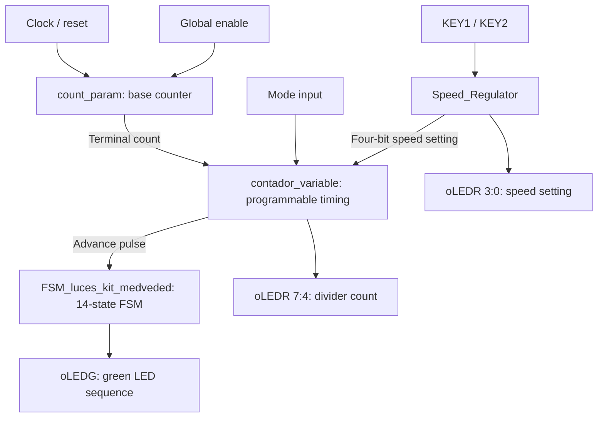

# Verilog FSM LED Sequencer

A configurable eight-LED running-light controller implemented in **Verilog HDL** for the **Terasic DE2-115 FPGA board**. Unlike a shift-register-based sequencer, this design uses a **fourteen-state finite-state machine (FSM)** to generate the LED pattern, together with a **Mealy FSM** and counters for button-controlled timing.

The design was developed using **Intel/Altera Quartus**, simulated in **ModelSim**, and tested on the DE2-115 according to the original verification report.

## Features

- **Fourteen-state LED FSM:** produces a single illuminated LED moving back and forth across eight outputs.
- **Variable sequence speed:** a programmable timing stage determines when the LED FSM advances.
- **Button-controlled speed setting:** KEY1 decreases and KEY2 increases the four-bit setting in the original active-low button convention.
- **Mealy control FSM:** detects button actions and generates counter enable/direction signals.
- **Selectable timing mode:** chooses between the full divider range and the programmable terminal-count setting.
- **Status outputs:** eight green LEDs show the sequence; eight red LEDs show timing and speed-control counts.

## Architecture



The top-level entity, **`Juego_de_luces_con_velocidad_variable`**, connects the counter, speed regulator, programmable divider, and LED-state machine. Inside `Speed_Regulator`, **`FSM_speed_MEALY`** controls a saturating four-bit **`count_UP_DOWN`** counter. The resulting speed setting is used by `contador_variable` when the corresponding mode is selected.

### LED sequence

The FSM moves through fourteen states, illuminating the LEDs in the following order:

```text
10000000 → 01000000 → 00100000 → 00010000
         → 00001000 → 00000100 → 00000010 → 00000001
         → 00000010 → 00000100 → 00001000 → 00010000
         → 00100000 → 01000000 → repeat
```

The state advances only when its enable input is asserted. Reset returns it to the first pattern.

## RTL modules

| Module | Responsibility |
| --- | --- |
| [`Juego_de_luces_con_velocidad_variable.v`](rtl/Juego_de_luces_con_velocidad_variable.v) | Integrates the complete LED sequencer. |
| [`FSM_luces_kit_medveded.v`](rtl/FSM_luces_kit_medveded.v) | Generates the fourteen-state LED pattern. |
| [`Speed_Regulator.v`](rtl/Speed_Regulator.v) | Connects the button FSM to the speed-setting counter. |
| [`FSM_speed_MEALY.v`](rtl/FSM_speed_MEALY.v) | Decodes button actions into counter enable and direction signals. |
| [`count_UP_DOWN.v`](rtl/count_UP_DOWN.v) | Saturating up/down speed-setting counter (0–15). |
| [`contador_variable.v`](rtl/contador_variable.v) | Variable timing stage with selectable terminal count. |
| [`count_param.v`](rtl/count_param.v) | Base clock counter and terminal-count generation. |

## Top-level interface

| Signal | Direction | Description |
| --- | --- | --- |
| `iCLK` | Input | System clock. |
| `iRST` | Input | Active-low reset. |
| `iENABLE` | Input | Enables the base timing stage. |
| `iModo` | Input | Selects variable terminal count (`1`) or full four-bit count range (`0`). |
| `iKey1` | Input | Speed decrease button in the original active-low hardware configuration. |
| `iKey2` | Input | Speed increase button in the original active-low hardware configuration. |
| `oLEDG[7:0]` | Output | Running-light sequence. |
| `oLEDR[7:4]` | Output | Current variable-counter value. |
| `oLEDR[3:0]` | Output | Speed-control setting. |

## Simulation and original verification

| Testbench | Covered behavior |
| --- | --- |
| [`tb_FSM_Medveded.v`](tb/tb_FSM_Medveded.v) | Normal fourteen-state sequence, enable hold, and reset. |
| [`tb_Speed_Regulator.v`](tb/tb_Speed_Regulator.v) | Button increments/decrements, simultaneous-button handling, count limits, and reset. |
| [`tb_Juego_de_luces_con_velocidad_variable.v`](tb/tb_Juego_de_luces_con_velocidad_variable.v) | Integrated sequence with timing changes. |

The original ModelSim verification covered the individual FSM, the regulator, and the combined system. The hardware validation on the DE2-115 checked **constant-speed mode**, button-controlled speed changes, and reset.

**Simulation considerations:** These are primarily stimulus-driven testbenches; they are not a complete automated assertion suite. The integrated testbench includes very long `repeat (500000000)` waits, so a full run can be slow. Its simulated button levels should be reviewed alongside the **active-low KEY convention** used by the hardware before interpreting speed-change results.

## Hardware and tools

| Item | Details |
| --- | --- |
| FPGA development board | Terasic DE2-115 |
| HDL | Verilog |
| FPGA design | Intel/Altera Quartus |
| Functional simulation | ModelSim |

## Repository layout

```text
Verilog-FSM-LED-Sequencer/
├── rtl/
│   ├── contador_variable.v
│   ├── count_param.v
│   ├── count_UP_DOWN.v
│   ├── FSM_luces_kit_medveded.v
│   ├── FSM_speed_MEALY.v
│   ├── Juego_de_luces_con_velocidad_variable.v
│   └── Speed_Regulator.v
├── tb/
│   ├── tb_FSM_Medveded.v
│   ├── tb_Juego_de_luces_con_velocidad_variable.v
│   └── tb_Speed_Regulator.v
└── README.md
```

## Reusing the design

Create a Quartus project for the DE2-115, add the seven RTL files, select **`Juego_de_luces_con_velocidad_variable`** as the top-level entity, and restore the relevant clock, buttons, switches, reset, and LED pin assignments. For ModelSim verification, compile the required RTL modules with the selected testbench.

**Scope:** This repository preserves the Verilog sources and testbenches of the **LED-sequencer portion** of the original work. It does not include the separate stepper-motor controller described in the larger design report, or the original Quartus project files and generated bitstreams. The historical validation results are documented; the sources have not been rerun for this README revision.
