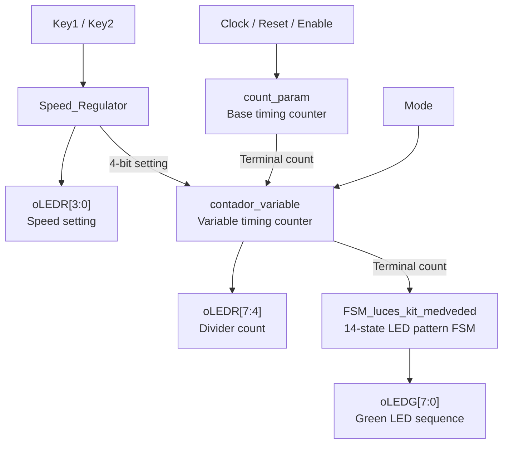

# Verilog FSM LED Sequencer

An FPGA-based LED sequencer implemented in **Verilog HDL**, combining finite state machines (FSMs), programmable timing, and button-controlled speed adjustment to produce a bidirectional running-light effect.

The design targets the **Terasic DE2-115** development board and was developed using **Intel/Altera Quartus**, with functional simulation in **ModelSim**.

## Features

- Eight-LED back-and-forth ("Knight Rider") lighting sequence.
- State-driven LED patterns with a **14-state FSM**.
- Adjustable sequence timing through a variable-count divider.
- Button-driven control implemented with a **Mealy FSM** and a saturating up/down counter.
- Selectable fixed or adjustable divider range.
- Separate green LED pattern and red LED status outputs.
- Testbenches covering the LED FSM, speed regulator, and integrated design.

## Architecture

The top-level module, `Juego_de_luces_con_velocidad_variable`, connects the timing, speed-control, and LED-sequencing blocks:



Inside `Speed_Regulator`, `FSM_speed_MEALY` interprets the button inputs and generates enable/direction signals for `count_UP_DOWN`. The resulting 4-bit setting controls `contador_variable` when its variable-range mode is selected.

### LED pattern

The LED-pattern FSM lights one of eight outputs at a time, moving from one end to the other and back. A new pattern state is selected only when its enable signal is asserted.

```text
10000000
01000000
00100000
00010000
00001000
00000100
00000010
00000001
00000010
00000100
00001000
00010000
00100000
01000000
(repeat)
```

## Repository structure

```text
Verilog-FSM-LED-Sequencer/
├── rtl/
│   ├── contador_variable.v
│   ├── count_param.v
│   ├── count_UP_DOWN.v
│   ├── FSM_luces_kit_medveded.v
│   ├── FSM_speed_MEALY.v
│   ├── Juego_de_luces_con_velocidad_variable.v
│   └── Speed_Regulator.v
├── tb/
│   ├── tb_FSM_Medveded.v
│   ├── tb_Juego_de_luces_con_velocidad_variable.v
│   └── tb_Speed_Regulator.v
└── README.md
```

## RTL modules

| Module | Purpose |
| --- | --- |
| `Juego_de_luces_con_velocidad_variable` | Top-level integration of timing, speed regulation, and LED sequencing. |
| `FSM_luces_kit_medveded` | Fourteen-state FSM that produces the back-and-forth eight-LED pattern. |
| `Speed_Regulator` | Combines button-event control with a 4-bit up/down speed-setting counter. |
| `FSM_speed_MEALY` | Four-state Mealy-style controller generating counter enable and direction signals from two button inputs. |
| `count_UP_DOWN` | Parameterized, saturating up/down counter; instantiated with a range of 0–15. |
| `contador_variable` | Timing counter that resets at a selected terminal value, determined by the mode input. |
| `count_param` | Parameterized base timing counter that generates a terminal-count pulse. |

## Top-level interface

**Module:** `Juego_de_luces_con_velocidad_variable`

| Port | Direction | Description |
| --- | --- | --- |
| `iCLK` | Input | System clock. |
| `iRST` | Input | Active-low reset for the integrated design. |
| `iENABLE` | Input | Enables the base timing counter. |
| `iModo` | Input | Selects the variable counter's terminal-count mode (`1`: speed setting; `0`: full 4-bit range). |
| `iKey1`, `iKey2` | Input | Button inputs used by the speed-control FSM. |
| `oLEDG[7:0]` | Output | Eight-bit running-light pattern. |
| `oLEDR[7:4]` | Output | Current count of the variable timing stage. |
| `oLEDR[3:0]` | Output | Four-bit speed setting. |

> **Button mapping note:** The original source comments and the `FSM_speed_MEALY` state/output logic do not consistently describe which button increments or decrements the setting. Verify the mapping against the RTL and simulation waveforms before relying on specific button assignments.

## Simulation and verification

The repository includes three testbenches originally used for functional verification in **ModelSim**:

| Testbench | Coverage |
| --- | --- |
| `tb_FSM_Medveded.v` | Normal LED sequencing, disabled state progression, and reset. |
| `tb_Speed_Regulator.v` | Button-input sequences, repeated changes, special input combinations, and reset. |
| `tb_Juego_de_luces_con_velocidad_variable.v` | Integrated LED sequence with button-driven timing changes. |

To simulate, compile the required files from `rtl/` together with the chosen testbench from `tb/`, select that testbench as the simulation top, and inspect the resulting waveforms.

**Simulation notes:**

- The testbenches are primarily **stimulus-driven**, with waveform inspection rather than automated self-checking assertions.
- The integrated testbench contains very long waits (`repeat (500000000)`), so a full simulation can take substantial time.
- The base timing counter defaults to `fin_cuenta = 5000000`; consider simulation-only parameter overrides or a reduced test configuration for faster experiments, without changing the original archived RTL.

## Hardware and tools

- **Target board:** Terasic DE2-115 FPGA development board.
- **HDL:** Verilog.
- **Design environment:** Intel/Altera Quartus.
- **Functional simulation:** ModelSim.

## Scope

This repository contains the original **Verilog RTL source files and testbenches** for the LED sequencer. Generated Quartus databases, compiled programming files, pin assignments, and full project configurations are intentionally excluded.

To rebuild the design for the DE2-115, create a Quartus project, add the RTL sources, select the top-level module, and configure the FPGA device and board pin assignments.
